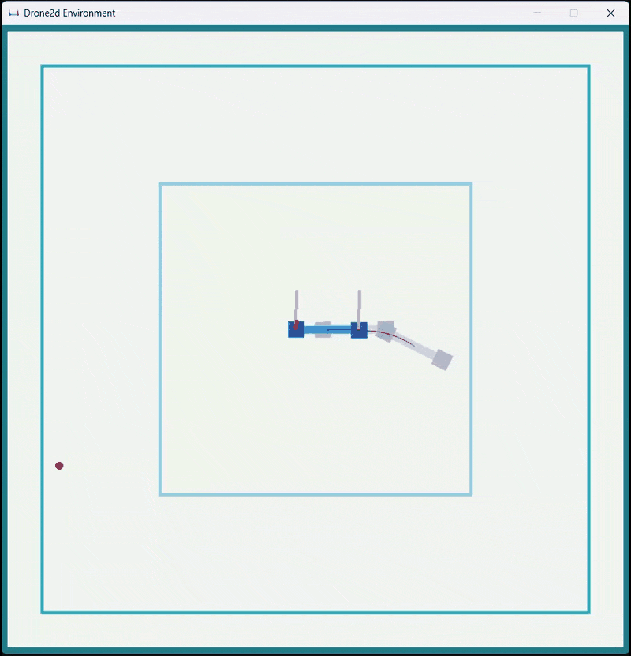
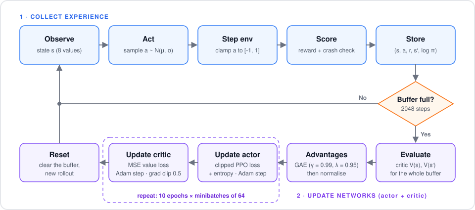
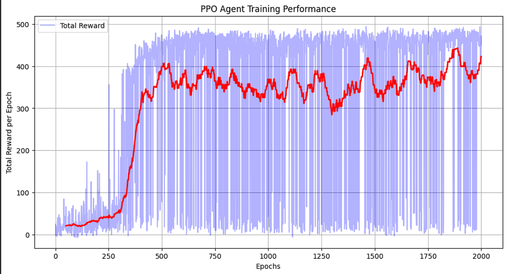

# RL 2D Pilot — PPO Drone Controller

**A Proximal Policy Optimization (PPO) agent, built from scratch in PyTorch, that learns to recover a randomly thrown 2D drone and fly it to a target using only two motor thrusts.**

<p align="center">
  
  
  
  
  
</p>

<p align="center">
  
</p>

## Table of Contents

- [Overview](#overview)
- [Objective](#objective)
- [Environment](#environment)
- [Action & State Spaces](#action--state-spaces)
- [Reward Function](#reward-function)
- [Algorithm: PPO](#algorithm-ppo)
- [Implementation Highlights](#implementation-highlights)
- [Hyperparameters](#hyperparameters)
- [Results](#results)
- [Installation](#installation)
- [Usage](#usage)
- [Project Structure](#project-structure)
- [Created by](#created-by)

## Overview

<details>
<summary><b>New to reinforcement learning? Click to expand.</b></summary>

<br>

- **Reinforcement Learning (RL)** is a branch of machine learning where an **agent** learns by interacting with an **environment**. At every step it observes a **state**, takes an **action**, and receives a **reward**.
- Nobody tells the agent what the right action is. It discovers good behaviour by **trial and error**, gradually shaping a **policy** (a mapping from states to actions) that maximises the total reward it collects over time.
- Think of learning to ride a bicycle: no one hands you the equations of balance. You wobble, fall, adjust, and over many attempts your body learns which small corrections keep you upright. The RL agent does the same thing, with rewards in place of "not falling".
- This makes RL a natural fit for **control problems** like flying a drone, where the right action depends on a constantly changing physical state and hand-writing a controller is hard.

</details>

This project applies deep RL to a classic control challenge: **stabilising and steering an underactuated 2D drone**. The drone has only two motors, so moving sideways means *tilting*, and tilting too far means *crashing*. The agent has to learn that balance on its own.

## Objective

Train an agent that can take control of a drone **thrown in a random direction with random force**, recover it, fly it to a target point, and hover there stably.

The agent must learn to:

- **Recover** from the initial uncontrolled fall (the motors are locked for the first few steps)
- **Coordinate** the left and right motor thrusts to control both altitude and tilt
- **Navigate** towards the target point
- **Stay safe**: never tilt past 90° and never leave the flight area

## Environment

This project uses the [Drone 2D custom Gym environment](https://github.com/marek-robak/Drone-2d-custom-gym-env-for-reinforcement-learning) (`drone-2d-custom-v0`), simulated with the Pymunk physics engine at 60 fps.

The arena is divided into three squares (visible in the demo above):

| Square | Purpose |
|--------|---------|
| Smallest | Area where the drone spawns, with a random tilt between −45° and 45° |
| Middle | Area where the target point can appear |
| Largest | Flight boundary. Leaving it ends the episode |

**Observation space**: 8 continuous values, all normalised to `[-1, 1]`:

| Index | Description |
|-------|-------------|
| 0 | Linear velocity, x |
| 1 | Linear velocity, y |
| 2 | Angular velocity |
| 3 | Pitch angle (±1 = ±90°) |
| 4 | Distance to target, x |
| 5 | Distance to target, y |
| 6 | Drone position in the arena, x |
| 7 | Drone position in the arena, y |

**Episode ends when:**

- 💥 **Crash**: the drone tilts past 90° (`|pitch| = 1`)
- 🚧 **Out of bounds**: the drone hits the flight boundary (`|x| = 1` or `|y| = 1`)
- ⏱️ **Time limit**: the maximum number of steps is reached (truncation, not a failure)

## Action & State Spaces

| Action | Range | Description |
|--------|-------|-------------|
| Left motor thrust | `[-1, 1]` | −1 = motor off, 1 = maximum lift force |
| Right motor thrust | `[-1, 1]` | −1 = motor off, 1 = maximum lift force |

Both spaces are **continuous**: an 8-dimensional state in and a 2-dimensional action out. The policy outputs a Gaussian distribution over the two thrusts. Actions are sampled during training and clamped to `[-1, 1]` before being sent to the environment.

## Reward Function

Instead of the environment's built-in reward, the agent is trained with a **custom, bounded reward** (`compute_reward` in [`drone_ppo/utils.py`](drone_ppo/utils.py)):

```math
R_t =
\begin{cases}
-10 & \text{if crashed} \\[4pt]
0.5\, e^{-d} \;+\; 0.5\, \cos\!\left(\theta \cdot \dfrac{\pi}{2}\right) & \text{otherwise}
\end{cases}
\qquad d = \sqrt{d_x^2 + d_y^2}
```

where $d_x, d_y$ are the distances to the target (observations 4 and 5) and $\theta$ is the normalised pitch (observation 3).

| Term | Encourages | Range |
|------|------------|-------|
| $0.5\,e^{-d}$ | Getting close to the target | 0 → 0.5 (on target) |
| $0.5\cos(\theta\pi/2)$ | Staying level | 0 → 0.5 (perfectly level) |
| −10 | Avoiding crashes and leaving the arena | Terminal penalty |

**Why a custom reward?** The environment's default reward, $\frac{1}{d_x+0.1} + \frac{1}{d_y+0.1}$, grows very large near the target, which makes value targets swing wildly. The custom reward is capped at **1.0 per step**. That keeps the critic's targets on a stable scale, and it rewards being level as well as being close.

## Algorithm: PPO

<details>
<summary><b>Why deep RL instead of classic RL? Click to expand.</b></summary>

<br>

- Tabular methods (Q-learning, Monte Carlo, TD) store a value for every state–action pair. That is impossible here, because both the state and the actions are **continuous**.
- Discretising them would either lose precision (jerky control) or blow up the table size.
- **Neural networks** act as function approximators. They generalise from the states the agent has seen to ones it hasn't, and they output continuous actions directly.

</details>

**Proximal Policy Optimization** is an on-policy **actor–critic** algorithm:

- The **actor** (policy network) decides what to do: it outputs a probability distribution over actions.
- The **critic** (value network) judges how good a state is: it predicts the expected future return.
- The critic's estimates turn noisy returns into **advantages** ("was this action better or worse than expected?"), and the actor is nudged towards actions with positive advantage.
- PPO **clips** each policy update so the new policy can't move too far from the old one in a single step.

### Networks in this project ([`drone_ppo/models.py`](drone_ppo/models.py))

| Network | Architecture | Output |
|---------|--------------|--------|
| Actor | `8 → 128 → 64 → 2`, Tanh activations | Mean thrust **μ** for each motor (Tanh-bounded), plus a learnable, state-independent **log σ** |
| Critic | `8 → 128 → 64 → 1`, Tanh activations | Scalar state value **V(s)** |

The actor and the critic have separate weights and separate Adam optimisers.

### Training loop ([`scripts/train.py`](scripts/train.py))

<p align="center">
  
</p>

### Core equations

**Policy**: a diagonal Gaussian over the two thrusts:

```math
a \sim \mathcal{N}\big(\mu_\phi(s),\, \sigma\big), \qquad \sigma = e^{\log\sigma}\ \text{(learned, state-independent)}
```

**Generalized Advantage Estimation (GAE)**:

```math
\delta_t = r_t + \gamma\, V(s_{t+1})\,(1 - \text{terminated}_t) - V(s_t)
\qquad
\hat{A}_t = \delta_t + \gamma \lambda\, (1 - \text{done}_t)\, \hat{A}_{t+1}
```

where:

| Symbol | Meaning |
|--------|---------|
| $\delta_t$ | TD error: how much better or worse step *t* turned out than the critic expected |
| $\hat{A}_t$ | Advantage: a discounted sum of future TD errors, telling the actor how good action $a_t$ was |
| $\text{terminated}_t$ | 1 if the episode **ended in a crash** at step *t* (tilt past 90° or out of bounds), else 0. A crash has no future, so $V(s_{t+1})$ is dropped |
| $\text{done}_t$ | 1 if the episode **ended for any reason** (crash *or* time limit), else 0. This stops advantages from leaking into the next episode |

On a **time-limit** ending, $\text{done}_t = 1$ but $\text{terminated}_t = 0$. The drone was still flying fine, so the critic keeps its estimate of the future value $V(s_{t+1})$ rather than treating the timeout as a failure.

**PPO clipped objective**, with an entropy bonus and ratio $r_t(\phi) = \frac{\pi_\phi(a_t \mid s_t)}{\pi_{\phi_\text{old}}(a_t \mid s_t)}$:

```math
L^{\text{actor}} = -\,\mathbb{E}_t\Big[\min\big(r_t \hat{A}_t,\ \text{clip}(r_t,\, 1-\epsilon,\, 1+\epsilon)\,\hat{A}_t\big)\Big] \;-\; c_\text{ent}\, \mathcal{H}[\pi_\phi]
```

```math
L^{\text{critic}} = \mathbb{E}_t\Big[\big(V(s_t) - (\hat{A}_t + V_\text{old}(s_t))\big)^2\Big]
```

### Why PPO for this task?

- **Stable learning**: a single unlucky batch (e.g. lots of crashes) can't wreck the policy, because clipping limits how far each update moves it.
- **Variance reduction**: drone physics makes the returns noisy. The critic baseline plus GAE turns them into much cleaner learning signals.
- **Native continuous control**: the Gaussian policy outputs real-valued thrusts directly, with no discretisation.
- **Simple and robust**: few moving parts compared with off-policy methods, and the standard hyperparameters work well out of the box.

## Implementation Highlights

Details in the code that matter for stable training:

- **Terminated vs truncated episodes**: a crash cuts off the value bootstrap, but hitting the time limit does not. Otherwise the critic would wrongly learn that "running out of time" is as bad as crashing.
- **Exact log-probabilities**: the *unclamped* sampled action is stored for the PPO ratio, and only the clamped copy goes to the environment. Recomputing the log-prob from the clamped action would bias the update.
- **Bounded reward**: each step earns at most 1.0, so the value targets stay well-scaled (see [Reward Function](#reward-function)).
- **Advantage normalisation**: advantages are standardised per rollout, so the policy step size doesn't depend on the reward scale.
- **Gradient clipping** (max norm 0.5) on both networks, plus an **entropy bonus** to keep exploring early on.
- **State-independent `log σ`**: one learnable exploration noise level per motor, which is simpler and more stable than predicting σ from the state.
- **Deterministic evaluation**: [`scripts/evaluate.py`](scripts/evaluate.py) flies with the mean action μ (no sampling noise) and reports the mean reward and crash rate.

## Hyperparameters

All values live in [`drone_ppo/config.py`](drone_ppo/config.py).

| Parameter | Value | Description |
|-----------|-------|-------------|
| `gamma` | 0.99 | Discount factor for future rewards |
| `lam` | 0.95 | GAE λ: bias–variance trade-off for advantages |
| `eps` | 0.2 | PPO clipping threshold |
| `learning_rate` | 3e-4 | Adam step size (actor and critic) |
| `ent_coef` | 0.01 | Entropy bonus weight, encourages exploration |
| `epochs` | 2000 | Number of training episodes |
| `N` | 2048 | Steps collected before each PPO update |
| `batch_size` | 64 | Minibatch size per gradient step |
| `update_epochs` | 10 | Passes over each rollout |
| `max_grad_norm` | 0.5 | Gradient clipping threshold |

## Results

<p align="center">
  
</p>

*Light blue: total reward per episode. Red: 50-episode moving average.*

### Pretrained weights

Trained actor weights are included in [`checkpoints/`](checkpoints):

| File | Training episodes |
|------|-------------------|
| `ppo(500).pth` | 500 |
| `ppo(1000).pth` | 1000 |
| `ppo(2000).pth` | 2000 (best, matches the reward curve above) |

`scripts/evaluate.py` loads `checkpoints/ppo(2000).pth` by default. To try another one, change `checkpoint` at the top of that file.

## Installation

```bash
git clone https://github.com/lokesh-singh2/RL_2d_PILOT.git
cd RL_2d_PILOT

python -m venv .venv
# Windows: .venv\Scripts\activate    |    Linux/macOS: source .venv/bin/activate

pip install -r requirements.txt
```

### Environment

Install the [2D drone environment](https://github.com/marek-robak/Drone-2d-custom-gym-env-for-reinforcement-learning) by marek-robak:

```bash
pip install drone-2d-custom-gym-env
```

Or install it from source:

```bash
git clone https://github.com/marek-robak/Drone-2d-custom-gym-env-for-reinforcement-learning.git
cd Drone-2d-custom-gym-env-for-reinforcement-learning/drone_2d_custom_gym_env_package
pip install -e .
```

> The code uses the **old gym API** (`reset() -> state`, `step() -> 4 values`), so `gym<0.26` is required.

## Usage

Run both commands from the repository root.

**Train**

```bash
python -m scripts.train
```

Weights are saved to `ppo(1000).pth`, and a reward plot is shown at the end of training. Change `save_path` in `drone_ppo/config.py` before each new run so you don't overwrite old weights.

**Evaluate** (renders the simulation)

```bash
python -m scripts.evaluate
```

Set `checkpoint` and `episodes` at the top of `scripts/evaluate.py`. The script prints the mean reward and crash rate.

## Project Structure

```
RL_2d_PILOT/
├── drone_ppo/          # core package
│   ├── config.py       # hyperparameters
│   ├── models.py       # actor & critic networks
│   └── utils.py        # GAE, action sampling, reward, plotting
├── scripts/
│   ├── train.py        # PPO training loop
│   └── evaluate.py     # load weights & run rendered episodes
├── checkpoints/        # trained model weights (.pth)
├── assets/             # GIF and plots for this README
├── requirements.txt
└── LICENSE
```

## Created by

- Lokesh Singh
- Ayush Shinde

## License

This project is licensed under the [MIT License](LICENSE).
